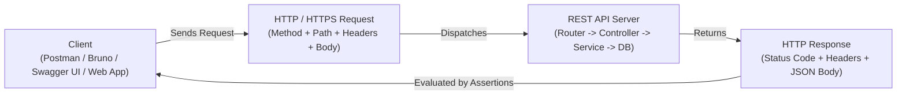
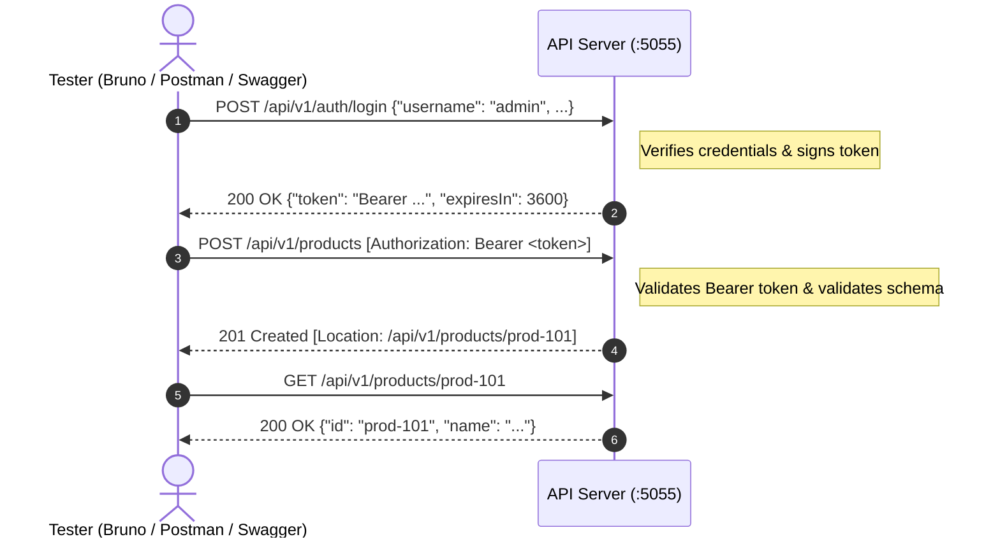
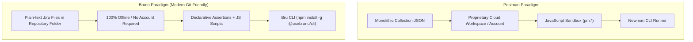
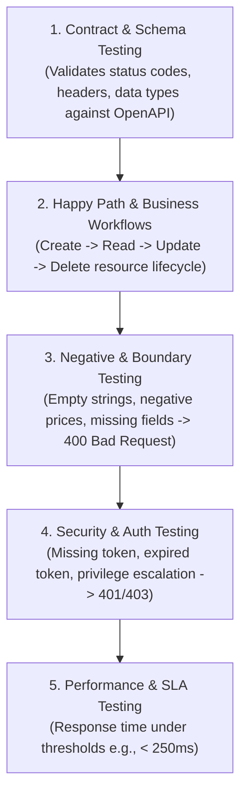

# API & API Testing Masterclass: Swagger, Bruno & Postman

Welcome to the complete, practical guide to **REST APIs and End-to-End API Testing**. This masterclass combines deep theoretical principles with a live, hands-on testing laboratory built directly in your workspace.

---

## 1. Core Architecture: What is a REST API?

An **API (Application Programming Interface)** is a formalized contract allowing software systems to exchange data and invoke operations across network boundaries. The dominant paradigm for web services is **REST (Representational State Transfer)**, an architectural pattern formulated by Roy Fielding.



### The Six REST Constraints

1. **Client-Server Separation:** The user interface/client is decoupled from data storage and server-side processing.
2. **Statelessness:** Every request must contain all necessary context (credentials, query parameters, payload). The server retains no session state between requests.
3. **Cacheability:** Responses must explicitly declare whether they are cacheable (via `Cache-Control` / `ETag`) to optimize network roundtrips.
4. **Layered System:** The client cannot tell whether it is connected directly to the end server or to intermediaries (load balancers, CDNs, API gateways).
5. **Code on Demand (Optional):** Servers can temporarily extend client functionality by transferring executable code (e.g., scripts).
6. **Uniform Interface:** Standardized resource URIs, HTTP verbs, and self-descriptive representations (usually JSON).

---

## 2. The Anatomy of an HTTP Transaction

Every API test you construct interrogates one or more elements of an HTTP transaction:



### Standard HTTP Methods (Verbs)

| Method | Idempotent? | Safe? | Typical Status | Purpose |
| :--- | :---: | :---: | :---: | :--- |
| `GET` | **Yes** | **Yes** | `200 OK` | Retrieve resource representation without modifying state. |
| `POST` | **No** | **No** | `201 Created` / `200 OK` | Create new resources, trigger computations, or submit credentials. |
| `PUT` | **Yes** | **No** | `200 OK` / `204 No Content` | Complete replacement or creation of resource at a specified URI. |
| `PATCH` | **No** | **No** | `200 OK` | Partial update of existing resource fields. |
| `DELETE` | **Yes** | **No** | `200 OK` / `204 No Content` | Remove resource at target URI. |
| `OPTIONS` | **Yes** | **Yes** | `204 No Content` / `200 OK` | Query permitted communication options / CORS preflight. |

> [!NOTE]
> **Idempotency** means making the identical request multiple times yields the same server state as making it once. `GET`, `PUT`, and `DELETE` are idempotent; `POST` is not.

### HTTP Status Code Taxonomy

- **`2xx Success`**:
  - `200 OK`: Request succeeded.
  - `201 Created`: Resource successfully created (standard for `POST`).
  - `204 No Content`: Succeeded, but no response body returned (common for `DELETE`).
- **`3xx Redirection`**:
  - `301 Moved Permanently` / `304 Not Modified` (Cache hit).
- **`4xx Client Errors`**:
  - `400 Bad Request`: Payload validation failed, malformed JSON, or missing required field.
  - `401 Unauthorized`: Authentication missing, expired, or invalid.
  - `403 Forbidden`: Authenticated, but lacks role/permission to access the resource.
  - `404 Not Found`: Target resource does not exist.
  - `422 Unprocessable Entity`: Syntactically valid JSON, but violates business validation rules.
- **`5xx Server Errors`**:
  - `500 Internal Server Error`: Unhandled server exception or crash.
  - `502 Bad Gateway` / `503 Service Unavailable`.

---

## 3. OpenAPI 3.0 & Swagger UI

### What is OpenAPI vs Swagger?
- **OpenAPI Specification (OAS):** The vendor-neutral, machine-readable standard (JSON or YAML) describing an API's endpoints, request bodies, query parameters, schemas, and security schemes.
- **Swagger:** The tooling ecosystem (founded by SmartBear) that builds upon OpenAPI, including:
  - **Swagger UI:** Generates an interactive web GUI directly from an OpenAPI specification document.
  - **Swagger Editor:** Browser-based editor with real-time OAS linting.
  - **Swagger Codegen:** Generates client SDKs and server stubs from an OAS file.

### Key OpenAPI Document Sections

```json
{
  "openapi": "3.0.3",
  "info": { "title": "Product API", "version": "1.0.0" },
  "servers": [{ "url": "http://localhost:5055" }],
  "paths": {
    "/api/v1/products": {
      "get": { ... },
      "post": {
        "security": [{ "BearerAuth": [] }],
        "requestBody": { ... },
        "responses": {
          "201": { "$ref": "#/components/schemas/Product" }
        }
      }
    }
  },
  "components": {
    "securitySchemes": {
      "BearerAuth": { "type": "http", "scheme": "bearer", "bearerFormat": "JWT" }
    },
    "schemas": { ... }
  }
}
```

### How to Test in Swagger UI
1. Navigate to `http://localhost:5055/docs`.
2. Expand the `POST /api/v1/auth/login` endpoint & click **Try it out**.
3. Execute the request using default test credentials (`admin` / `password123`). Copy the resulting `token`.
4. Scroll to the top of Swagger UI and click the green **Authorize** button. Paste the token into the input.
5. All protected endpoints (`POST /api/v1/products`, `PUT`, `DELETE`, `GET /api/v1/stats`) now execute with that token automatically injected into the `Authorization: Bearer <token>` header!

---

## 4. Postman vs Bruno: Deep Comparison



### Feature Comparison Matrix

| Feature | Postman | Bruno |
| :--- | :--- | :--- |
| **Storage Format** | Large monolithic JSON collection files | Plain-text `.bru` files organized by folder |
| **Git / Version Control** | High risk of merge conflicts in single huge JSON | Flawless git branching, diffing, and merging |
| **Cloud Dependency** | Requires cloud account; syncs requests to cloud | **100% offline & local**; data never leaves disk |
| **Pricing / Limits** | Free tier restricts collection runs (25/mo) | **Unlimited & Open Source** (MIT License) |
| **Scripting Engine** | `pm.test()`, `pm.expect()`, `pm.environment` | `assert { ... }` blocks + `bru.setEnvVar()` |
| **CI/CD Automation** | Newman CLI (`npm i -g newman`) | Bruno CLI (`bru run --env local`) |
| **Learning Curve** | Feature-heavy GUI, enterprise focus | Fast, lightweight, developer-first |

---

## 5. Test Authoring Syntax: Postman vs Bruno

### 1. Extracting & Saving an Auth Token

````carousel
```javascript
// Postman Tests Script (JavaScript)
pm.test("Status code is 200", function () {
    pm.response.to.have.status(200);
});

pm.test("Save Bearer Token", function () {
    const data = pm.response.json();
    pm.expect(data.token).to.be.a("string");
    
    // Dynamically persist token to current environment
    pm.environment.set("bearerToken", data.token);
});
```
<!-- slide -->
```bru
# Bruno Syntax (.bru file)
meta {
  name: Login
  type: http
}

post {
  url: {{baseUrl}}/api/v1/auth/login
  body: json
}

body:json {
  { "username": "admin", "password": "password123" }
}

assert {
  res.status: eq 200
  res.body.token: isDefined
}

script:post-response {
  bru.setEnvVar("token", res.body.token);
}
```
````

### 2. Validating Array Length & Nested Fields

````carousel
```javascript
// Postman: Schema & Response Validation
pm.test("Pagination & Array Structure", function () {
    const body = pm.response.json();
    pm.expect(body.items).to.be.an("array");
    pm.expect(body.items.length).to.be.above(0);
    pm.expect(body.pagination.page).to.eql(1);
    
    // Performance assertion
    pm.expect(pm.response.responseTime).to.be.below(500);
});
```
<!-- slide -->
```bru
# Bruno: Declarative Assertions
assert {
  res.status: eq 200
  res.body.items: isDefined
  res.body.pagination.total: gte 1
  res.responseTime: lte 500
}
```
````

---

## 6. API Testing Methodologies & Test Pyramid

A robust API test suite must span several test dimensions:



### Essential Test Categories

1. **Happy Path Testing:** Verifying expected behavior when correct inputs are provided (e.g., valid credentials produce `200`, valid item payload creates `201`).
2. **Negative Testing:** Ensuring the server fails gracefully with correct HTTP status codes when given bad input (e.g., missing price returns `400`, bad credentials returns `401`).
3. **Boundary Testing:** Submitting minimum/maximum values (e.g., `price: 0.01`, `page: 1`, `limit: 50`).
4. **Security Testing:** Verifying protected routes cannot be reached without an `Authorization: Bearer <token>` header, and rejected with `401 Unauthorized`.
5. **State & Idempotency Testing:** After `DELETE /products/101`, verifying that a subsequent `GET /products/101` returns `404 Not Found`.

---

## 7. Hands-on Lab Files & Usage Guide

All project files have been built and configured in:
`C:\Users\DC\.gemini\antigravity\scratch\api-testing-mastery`

### File Manifest

- [server.ps1](file:///C:/Users/DC/.gemini/antigravity/scratch/api-testing-mastery/server.ps1): Zero-dependency REST API server with interactive Swagger UI and dashboard.
- [openapi.json](file:///C:/Users/DC/.gemini/antigravity/scratch/api-testing-mastery/openapi.json): Standard OpenAPI 3.0.3 specification.
- [test-runner.ps1](file:///C:/Users/DC/.gemini/antigravity/scratch/api-testing-mastery/test-runner.ps1): Automated CLI test suite runner (12 test cases).
- [postman/Products_API.postman_collection.json](file:///C:/Users/DC/.gemini/antigravity/scratch/api-testing-mastery/postman/Products_API.postman_collection.json): Full Postman Collection v2.1.
- [postman/Local_Environment.postman_environment.json](file:///C:/Users/DC/.gemini/antigravity/scratch/api-testing-mastery/postman/Local_Environment.postman_environment.json): Postman Environment variables.
- [bruno/](file:///C:/Users/DC/.gemini/antigravity/scratch/api-testing-mastery/bruno): Bruno collection folder containing `bruno.json`, `environments/local.bru`, and `.bru` requests.
- [fastapi_alternative/main.py](file:///C:/Users/DC/.gemini/antigravity/scratch/api-testing-mastery/fastapi_alternative/main.py): Production Python / FastAPI reference code.
- [express_alternative/server.js](file:///C:/Users/DC/.gemini/antigravity/scratch/api-testing-mastery/express_alternative/server.js): Production Node.js / Express reference code.

---

## 8. Step-by-Step Instructions: Running & Testing

### Step 1: Starting the REST API Server
The server is currently running in the background at `http://127.0.0.1:5055`. If you restart it in your terminal:
```powershell
cd C:\Users\DC\.gemini\antigravity\scratch\api-testing-mastery
powershell -ExecutionPolicy Bypass -File .\server.ps1
```

### Step 2: Testing with Swagger UI
1. Open your browser and navigate to:
   **`http://localhost:5055/docs`**
2. Test `POST /api/v1/auth/login` with `{"username": "admin", "password": "password123"}`.
3. Click the **Authorize** lock icon at the top and paste the token.
4. Execute `GET /api/v1/products` and test parameters like `category: Audio`.

### Step 3: Testing with Postman
1. Open Postman.
2. Click **Import** (top left).
3. Select the file:
   `C:\Users\DC\.gemini\antigravity\scratch\api-testing-mastery\postman\Products_API.postman_collection.json`
4. Also import the environment:
   `C:\Users\DC\.gemini\antigravity\scratch\api-testing-mastery\postman\Local_Environment.postman_environment.json`
5. Select **Local API Testing Environment** in Postman's environment dropdown.
6. Click the Collection name &rarr; **Run collection** &rarr; click **Run Product Catalog API**.
   - Notice how `POST Login` automatically saves the token to `{{bearerToken}}`.
   - `POST Create Product` automatically stores `{{createdProductId}}`.
   - The subsequent `GET`, `PUT`, and `DELETE` requests use that ID automatically!

### Step 4: Testing with Bruno
1. Open Bruno ([usebruno.com](https://www.usebruno.com/)).
2. Click **Open Collection** on the welcome screen.
3. Browse to and select the directory:
   `C:\Users\DC\.gemini\antigravity\scratch\api-testing-mastery\bruno`
4. In the top right environment dropdown, select **local**.
5. Click **Run** on the collection runner, or click through the requests `01` to `12`.
6. Watch the instant pass/fail assertion checks execute in real time.

### Step 5: Automated Command-Line Execution
Run the automated PowerShell runner:
```powershell
cd C:\Users\DC\.gemini\antigravity\scratch\api-testing-mastery
.\test-runner.ps1
```
Result: All 12 automated tests will execute with green pass indicators and latency benchmarks.
